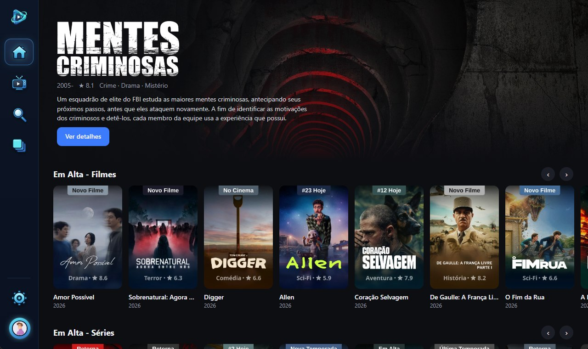
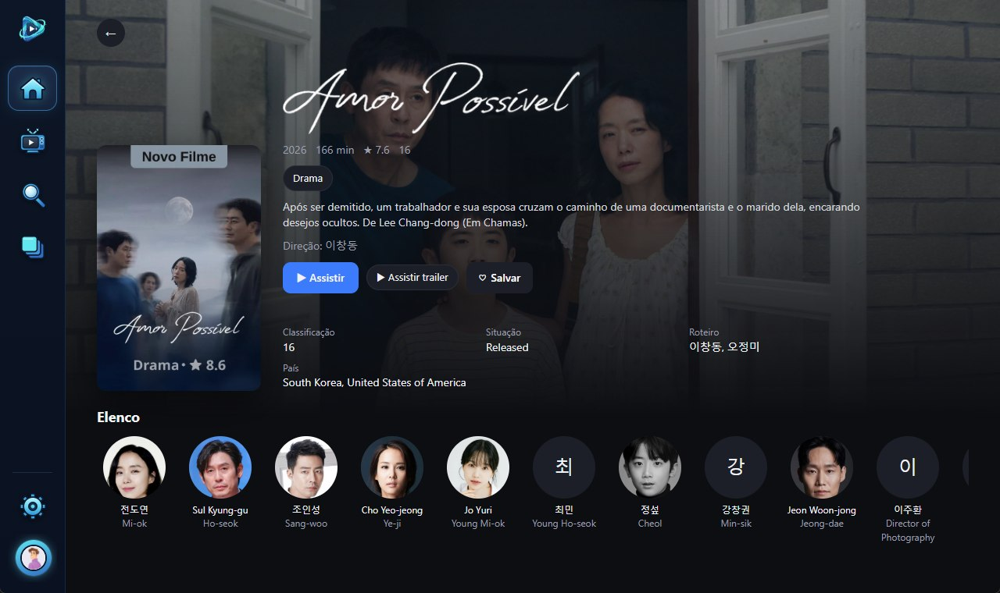
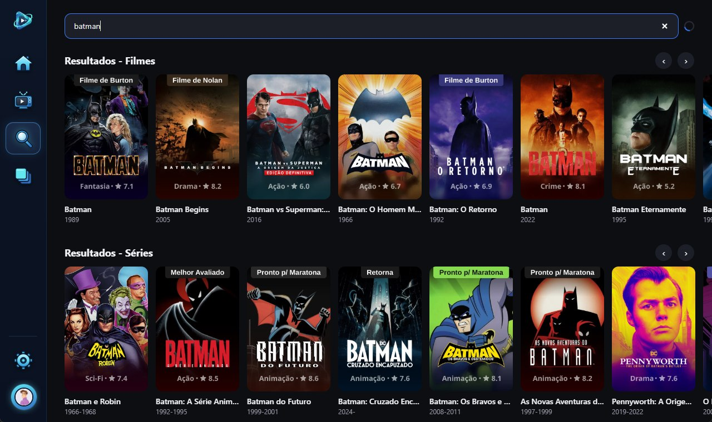
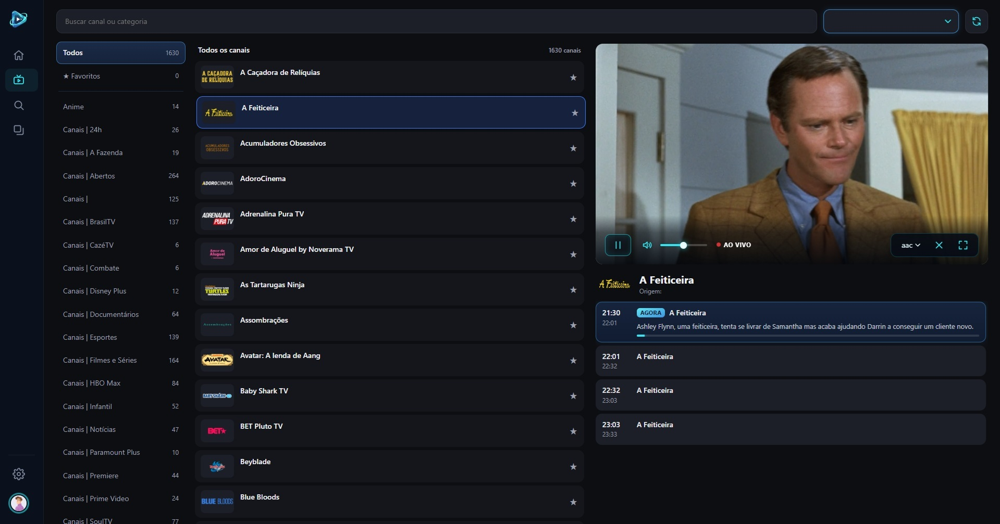

<p align="center">
  
</p>

<h1 align="center">Nuvio Astra — Enhanced Fork</h1>

<p align="center">
  An enhanced Windows fork of <a href="https://github.com/ScottGzin/NuvioAstra"><b>ScottGzin/NuvioAstra</b></a> (built on <b>Rust + Tauri + libmpv</b>),<br/>
  bringing desktop cinema gestures, in-player source/episode/chapter drawers, manual watched tracking, spoiler blur, and automatic source fallback.
</p>

<p align="center">
  
  
  
  
</p>

<p align="center">
  <a href="https://github.com/M7QHT/NuvioAstra/releases/latest"><b>⬇️ Download Latest Windows Installer</b></a>
</p>

---

## ✨ What's Different in This Fork?

This fork stays synced with **100% of upstream `ScottGzin/NuvioAstra`** (including official **English / Arabic RTL / Portuguese** UI, **TorBox Instant**, **Downloads**, **FPS Meter**, and **Card Styling**), and adds the following exclusive enhancements:

| Feature | Upstream (`ScottGzin/NuvioAstra`) | This Fork (`M7QHT/NuvioAstra`) |
| :--- | :---: | :---: |
| **Double-click anywhere on video → Fullscreen** | Control bar only | ✅ Full video canvas |
| **Press & Hold on video → Temporary `2x` Speed** | ❌ | ✅ Hold (~240ms) for `2x ⏩`, release to restore |
| **Single-click on video → Play / Pause** | ❌ | ✅ Smart debounce (no conflict with double-click / hold) |
| **Mouse Wheel over video → Volume ±5% + OSD** | ❌ | ✅ Smooth volume scroll with center OSD |
| **In-Player `Sources` Drawer (`S`)** | ❌ | ✅ Switch streams without leaving video & **resume at exact second** |
| **In-Player `Episodes` Drawer (`E`)** | Next episode only | ✅ Browse all seasons & episodes inside the player |
| **In-Player `Chapters` Drawer** | ❌ | ✅ Jump directly to any video chapter |
| **Quick Subtitle Sync (`G` / `H`)** | Menu only | ✅ Instant ±100ms keyboard sync with OSD feedback |
| **Media Info Overlay (`I`)** | ❌ | ✅ Resolution, codec, FPS, HW decoder, buffer & dropped frames |
| **Manual Watched Toggle (Rust `nuvio-store`)** | ❌ | ✅ Mark/unmark movies & episodes watched (account-synced) |
| **Blur Unwatched Episode Thumbnails** | ❌ | ✅ Spoiler blur toggle in Settings + quick button on Details |
| **Auto-Fallback on Source Failure** | ❌ | ✅ Automatically tries next playable direct source on failure |
| **Active Playing Source Highlight** | ❌ | ✅ Highlights current stream with `Playing` badge |
| **Right-Click Poster & Continue Watching Menus** | ❌ | ✅ Quick actions: Details, Library, Mark Watched, Remove, Copy title |
| **Sources Filter Bar** | ❌ | ✅ Instant chips (`All`, `4K`, `1080p`, `HDR/DV`, `Instant/Direct`) |
| **Mark Entire Season Watched** | ❌ | ✅ One-click season watched toggle + toast feedback |
| **Player Finish Time (`Ends at HH:MM`)** | ❌ | ✅ Live finish time next to playback clock (speed-aware) |
| **Desktop Navigation (`Mouse Back`, `Alt+←`, `Ctrl+K`)** | ❌ | ✅ Browser-like back navigation & instant `/` or `Ctrl+K` search |
| **See All Catalog Grid & Discover Screen** | ❌ | ✅ Full-page `See all →` grids + Stremio-style **Discover** tab with genre/type filters |

---

## 🎮 Player Gestures & Keyboard Shortcuts

| Input | Action |
| :--- | :--- |
| **Left Click** (empty video area) | Play / Pause |
| **Double Click** (empty video area) | Toggle Fullscreen |
| **Press & Hold** (~240ms on video) | Temporary **2x speed** (`2x ⏩` pill; releases back to previous speed) |
| **Mouse Wheel** (over video) | Volume ±5% (with OSD) |
| `Space` / `K` | Play / Pause |
| `←` / `→` or `J` / `L` | Seek ±10 seconds (`Shift + ←/→` for ±30s) |
| `↑` / `↓` | Volume ±5% |
| `M` | Mute / Unmute |
| `F` | Toggle Fullscreen |
| `S` | Open/Close **Sources** drawer (keeps exact timestamp) |
| `E` | Open/Close **Episodes** drawer (series) |
| `N` | Open **Next Episode** panel |
| `G` / `H` | Subtitle delay `-100ms` / `+100ms` |
| `I` | Toggle **Media Info** overlay |
| `Esc` | Close drawer / overlay or exit player |

---

## 📸 Screenshots

| Home | Details |
| :---: | :---: |
|  |  |
| **Search** | **Live TV & EPG** |
|  |  |

<sub>Catalogs, artwork, and streams come solely from user-installed addons. No media content is included with the application.</sub>

---

## 🚀 All Included Features (Upstream + Fork)

- **Multi-Language UI:** Official **English**, **Arabic (RTL)**, and **Portuguese** support in **Settings → Profile & Data** (synced with your Nuvio account).
- **TorBox & P2P Streaming:** Built-in **TorBox** integration (`TB Instant` cached playback) plus native `nuvio_engine.dll` P2P torrent streaming.
- **Built-in Downloads:** Download HTTP, TorBox, or torrent sources with multi-connection resume directly from the player or right-click menu.
- **High-End Video Engine (`libmpv`):** Hardware decoding, **Anime4K** presets, **NVIDIA RTX Video Super Resolution & HDR**, motion smoothing, **FPS Meter**, and full subtitle appearance customization.
- **Smart Watching:** Auto-skip intro/recap/credits (IntroDB, AniSkip, chapters), customizable watched threshold (90%–100%), manual **Watched** toggles, **Spoiler Blur**, and **Auto-Fallback** on broken streams.
- **Profiles & Sync:** Multi-profile support with PIN locks, avatars, and automatic Nuvio account sync.

---

## 💻 Installation

1. Go to the [**Latest Release**](https://github.com/M7QHT/NuvioAstra/releases/latest) page.
2. Download `Nuvio-Astra-<version>-x64-setup.exe` directly.
3. Run the installer (no administrator privileges required). Checksums are provided in `SHA256SUMS.txt`.

**Requirements:** Windows 10 or Windows 11 (64-bit) with Microsoft Edge WebView2 (pre-installed on Windows 11).

> **Note:** Since the installer is unsigned, Windows SmartScreen may ask for confirmation on first launch (**More info → Run anyway**). App data is stored in `%APPDATA%\NuvioNextGen` and preserved across updates.

---

## 🛠️ Build from Source

```powershell
cargo test --workspace
cd apps\nuvio-desktop\web; npm ci; npm run build; cd ..\..\..
cargo build --release -p nuvio-desktop
powershell -NoProfile -ExecutionPolicy Bypass -File packaging\windows\build-release.ps1 -SkipBuild -LibMpv <path\to\libmpv-2.dll>
```

---

## 📜 Credits & License

- **Upstream Project:** [ScottGzin/NuvioAstra](https://github.com/ScottGzin/NuvioAstra) © 2026 ScottGzin & contributors (GPL-3.0).
- **Original Project:** [NuvioMedia/NuvioDesktop](https://github.com/NuvioMedia/NuvioDesktop) © NuvioMedia & contributors (GPL-3.0).
- **License:** [GNU General Public License v3.0](LICENSE).

> **Disclaimer:** This project is an independent community fork and is not affiliated with or endorsed by NuvioMedia. The application does not host, provide, or distribute any media content.
